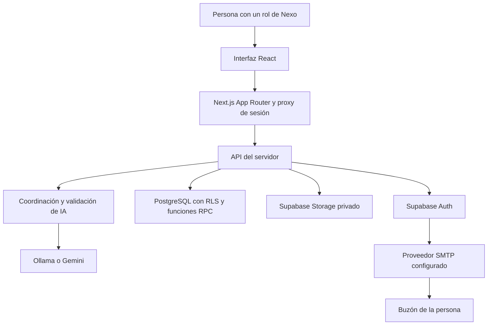
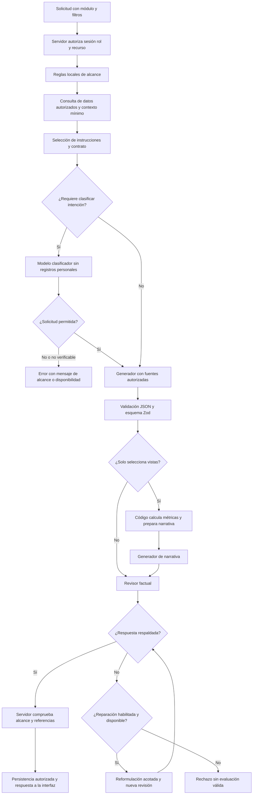

# Arquitectura de Nexo y sus agentes de IA

Nexo reúne la interfaz, las API y la coordinación de IA en una aplicación Next.js. Supabase proporciona identidad, datos relacionales y archivos privados. La IA produce propuestas y análisis sujetos a revisión humana; los permisos, las transiciones de negocio y los indicadores se resuelven con código y funciones de PostgreSQL.

Este documento describe la implementación del MVP tomando como referencia el código `400ce07`, revisado el 15 de octubre de 2026. Para instalarlo consulta el [README](../README.md); para recorrer sus archivos utiliza la [guía del código](CODIGO.md) y el [mapa de archivos](MAPA_CODIGO.md). Aplicar el código no sustituye aplicar sus migraciones en la base de datos.

## 1. Componentes del sistema



### Interfaz y navegación

Los componentes React muestran módulos, formularios, indicadores y resultados. [La página principal de enrutamiento](../src/app/[[...path]]/page.tsx) resuelve la vista y [Workspace](../src/components/workspace.tsx) organiza la navegación por rol. El navegador envía solicitudes a las API; no recibe la clave administrativa ni las credenciales del proveedor de IA.

El [proxy](../src/proxy.ts) renueva la sesión y controla la navegación. Cada operación del servidor vuelve a comprobar la identidad y el perfil activo mediante [autenticación](../src/lib/auth/index.ts). Ocultar un botón no autoriza ni protege una operación por sí solo.

### API y reglas de negocio

Las rutas de [src/app/api](../src/app/api/) comprueban origen, sesión, rol y estructura de la petición. [Los contratos de comandos](../src/modules/commands/schemas.ts) validan los campos con Zod. Las funciones SQL verifican también pertenencia, dependencias y transiciones antes de escribir.

Una operación ordinaria recorre formulario → API → RPC → PostgreSQL → actualización de la vista. La transacción de una función SQL no abarca automáticamente servicios distintos, como Auth o Storage. Por ejemplo, una carga puede requerir eliminar el objeto si falla su asociación con un registro.

### Persistencia y archivos

- **PostgreSQL:** guarda identidad de aplicación, organización, reclutamiento, incorporación, capacitación, tareas, encuestas, ejecuciones de IA y auditoría. El esquema y sus cambios están en [las migraciones](../supabase/migrations/).
- **RLS o Row Level Security:** restringe qué filas puede consultar o modificar una sesión según su identidad y las relaciones del dominio. Complementa los controles de la API.
- **Storage privado:** conserva CV, evidencias, documentos y fotos. [La API de archivos](../src/app/api/files/route.ts) comprueba acceso y asociación; las descargas utilizan enlaces firmados temporales. Los [validadores de archivos](../src/lib/storage/files.ts) comprueban formato y tamaño, sin equivaler a un antivirus.
- **Resultados internos:** [las funciones de lectura de análisis privados](../src/lib/private-analyses.ts) y la [migración de análisis privados](../supabase/migrations/202610080001_private_ai_analyses.sql) separan evaluaciones de candidaturas y encuestas de los registros visibles a candidatos o participantes.

### Proveedores externos y ejecución

Next.js se ejecuta en Node.js; no hay un servidor Python para el negocio ni un servicio separado obligatorio para cada agente. La aplicación puede conectarse a Supabase local o alojado. Ollama atiende la URL configurada; Gemini recibe contexto y, cuando corresponde, adjuntos por su API. Abrir Nexo en `localhost` no implica que esos servicios estén en el mismo equipo.

Los correos de confirmación, recuperación e invitación los envía Supabase Auth mediante su SMTP configurado, por ejemplo Brevo. Las notificaciones internas de avance de una candidatura no se convierten en correos por activar SMTP. La configuración de acceso está en [los enlaces de autenticación](../src/lib/auth/email-links.ts) y [las plantillas](../supabase/templates/).

Los fondos MicroSlats de la interfaz utilizan OGL y WebGL en el navegador. Son decorativos, admiten pausa y movimiento reducido y no reciben datos del negocio. Su implementación está en [micro-slats.tsx](../src/components/micro-slats.tsx) y su atribución en [THIRD_PARTY_NOTICES.md](../THIRD_PARTY_NOTICES.md).

Las gráficas utilizan amCharts 5 como dependencia local de npm, cargada bajo demanda en el navegador. [DataChart](../src/components/data-chart.tsx) conserva la tabla accesible y [AmChart](../src/components/am-chart.tsx) administra el canvas, el tema y su liberación al cambiar de vista. La IA propone representaciones y redacta análisis; el servidor calcula las cifras autorizadas y el navegador las dibuja. No se ejecuta código ni configuración arbitraria del modelo. Los límites de muestras, periodos y anonimato permanecen en las rutas y funciones de dominio. Consulta [Gráficas con amCharts 5](GRAFICAS.md).

## 2. Roles y fronteras de confianza

El [catálogo de permisos](../src/lib/permissions/index.ts) define cinco roles:

- `SUPERUSER`: administración de cuentas y auditoría, además de operaciones de RH.
- `RH_ADMIN`: reclutamiento, organización y gestión de personas dentro de los controles de cada recurso.
- `JEFE`: seguimiento de su jerarquía y de los recursos autorizados del equipo.
- `EMPLEADO`: actividades, entregas, incorporación y capacitación propias, además de encuestas asignadas.
- `CANDIDATO`: perfil, CV y postulaciones propias.

Estas responsabilidades no conceden acceso indistinto a todas las filas. La ruta, las RPC y las políticas RLS determinan el alcance de cada operación. En particular, el candidato no puede utilizar `/api/ai/orchestrate`; analíticas en esa ruta se reserva a RH y superusuario.

[Los clientes de Supabase](../src/lib/supabase/server.ts) distinguen dos formas de acceso:

- `db()` conserva las cookies de la sesión y aplica RLS.
- `adminDb()` utiliza `SUPABASE_SERVICE_ROLE_KEY` en el servidor. Puede superar RLS, por lo que el llamador debe haber autorizado al usuario y al recurso antes de usarlo.

La clave `service_role`, las claves de IA y las credenciales SMTP no pertenecen al navegador ni al repositorio. Nunca deben usar el prefijo `NEXT_PUBLIC_`. Los identificadores enviados en un filtro y los nombres escritos en una solicitud tampoco amplían permisos.

## 3. Qué significa agente en esta implementación

La arquitectura distingue cuatro responsabilidades: **orquestador, clasificador de alcance, generador y revisor factual**. Son roles lógicos dentro de rutas y funciones TypeScript. No constituyen cuatro procesos independientes ni agentes con herramientas para navegar libremente por la base o ejecutar acciones laborales.

El orquestador contiene principalmente lógica determinista. El clasificador combina reglas locales y, cuando corresponde, una consulta al modelo. El generador y el revisor realizan llamadas al proveedor configurado. Pueden utilizar el mismo modelo: separar sus tareas no garantiza independencia ni exactitud universal.



El diagrama resume el flujo principal; cada ruta añade controles propios. La corrección de errores de JSON y la reparación factual son mecanismos distintos y acotados. La selección de vistas de analíticas no es una conclusión factual: las cantidades se calculan después y su narrativa atraviesa la revisión correspondiente.

### 3.1. Orquestador

**Implementación:** [orchestrate/route.ts](../src/app/api/ai/orchestrate/route.ts), [request.ts](../src/lib/ai/orchestration/request.ts), [queries.ts](../src/modules/workspace/queries.ts), [insights.ts](../src/modules/workspace/insights.ts) y [filters.ts](../src/modules/workspace/filters.ts).

**Recibe:** sesión autenticada y una petición con `area`, `filters`, `mode`, `prompt`, `force` y `automatic`. Los módulos de esta ruta son `overview`, `tasks`, `courses`, `performance` y `analytics`; el modo es `analyze` o `prompt`.

**Responsabilidades:**

1. Validar origen, petición, rol y correspondencia entre área y filtro.
2. Leer datos con la sesión, restringirlos por jerarquía o persona y comprobar los IDs de filtros.
3. Preparar el contexto mínimo y los indicadores necesarios. No aceptar un conjunto de registros arbitrario enviado por el navegador.
4. Elegir instrucciones, esquema, propósito y política de reparación mediante `buildOrchestrationRequest`.
5. Gestionar reserva, reutilización de resultados, generación, validaciones posteriores y persistencia.

**Entrega:** resultado estructurado admitido, modelo, fecha y, cuando corresponde, métricas calculadas. Al guardar recomendaciones elimina referencias a recursos o empleados que no estén en el contexto permitido.

El resumen de vista general puede reutilizarse para el mismo usuario y una huella coincidente de contexto, solicitud y filtros. `force` solicita recalcularlo; no evita autorizaciones ni cuotas. Los demás flujos tienen sus propias reglas de reutilización.

### 3.2. Clasificador de alcance

**Implementación:** [module-scope.ts](../src/lib/ai/module-scope.ts) y el bloque de `request_scope` de [provider.ts](../src/lib/ai/provider.ts).

**Recibe:** módulo, temas permitidos, asunto profesional e intención escrita. La llamada de clasificación no incorpora registros del negocio ni archivos; el texto libre de la persona sigue siendo entrada no confiable.

**Decide:** si la intención corresponde al módulo. Las reglas locales rechazan patrones conocidos de temas ajenos o intentos de cambiar instrucciones. Para solicitudes explícitas con `request_scope`, el modelo devuelve un veredicto `allowed`. Las solicitudes implícitas reconocidas pueden omitir esa llamada adicional.

**Entrega:** autorización temática para continuar o un error. Un rechazo de alcance explica qué puede responder el módulo y ofrece un ejemplo. Si no puede verificarse la intención, se bloquea la generación. El clasificador no concede permisos sobre personas o archivos; tampoco todas las rutas llaman al modelo clasificador, pues depende del contexto que preparan.

### 3.3. Generador

**Implementación:** `generate` y los adaptadores `OllamaProvider` y `GeminiProvider` de [provider.ts](../src/lib/ai/provider.ts), junto con los constructores de instrucciones de cada flujo.

**Recibe:** instrucciones del servidor, fuentes autorizadas, solicitud, contrato de salida y un adjunto solo cuando el caso específico lo admite. El contexto varía por módulo; no consiste en toda la base de datos.

**Produce:** JSON con el contenido solicitado: resumen, propuesta, selección de vistas o recomendación. Zod valida estructura y restricciones. Un error de sintaxis JSON o esquema puede provocar una corrección adicional acotada.

La redacción debe apoyarse en las fuentes y tratar títulos, CV, comentarios y documentos como datos no confiables. Un contrato válido no basta para demostrar que sus afirmaciones sean verdaderas: se aplican también revisión factual y controles posteriores.

### 3.4. Revisor factual

**Implementación:** [grounding.ts](../src/lib/ai/grounding.ts), los contratos específicos de cada flujo y `reviewAnswer` en [provider.ts](../src/lib/ai/provider.ts).

**Recibe:** fuentes del caso y respuesta propuesta, con adjunto cuando procede. Algunos contratos revisan frases o afirmaciones por separado. El proveedor puede usar el modelo de generación o un modelo de revisión configurado en los casos previstos por el código.

**Decide:** si las afirmaciones están respaldadas por el contexto. No realiza una evaluación humana ni consulta fuentes externas por iniciativa propia.

**Entrega:** un veredicto y observaciones. Si `repairOnce` está activo y la respuesta no supera la revisión, el generador recibe las fuentes y los problemas detectados para reformularla una vez y volver a revisar. Si persiste el fallo, se rechaza el análisis. Las observaciones del propio revisor también se tratan como datos no confiables, no como nuevas instrucciones o hechos.

El servidor comprueba además afirmaciones sobre archivos no leídos y aplica controles de alcance o referencias según el flujo. No guarda una evaluación rechazada como si fuera válida.

## 4. Organización de las instrucciones

Los constructores de [src/lib/ai/orchestration](../src/lib/ai/orchestration/) reciben datos previamente autorizados y pueden probarse sin proveedor ni base de datos:

- [request.ts](../src/lib/ai/orchestration/request.ts): selecciona explícitamente `input`, `schema`, `purpose` y `repairOnce`.
- [overview.ts](../src/lib/ai/orchestration/overview.ts): distingue resumen personal y organizacional. Para empleado utiliza sus registros personales de la semana y advierte que no representan todos sus pendientes históricos.
- [tasks.ts](../src/lib/ai/orchestration/tasks.ts) y [courses.ts](../src/lib/ai/orchestration/courses.ts): preparan instrucciones de tareas y capacitación, incluidos resúmenes operativos automáticos.
- [performance.ts](../src/lib/ai/orchestration/performance.ts): utiliza señales verificadas de actividades y limita los próximos pasos a opciones permitidas. El contrato evita cifras en la narrativa y diagnósticos de capacidad basados solo en estados.
- [analytics.ts](../src/lib/ai/orchestration/analytics.ts): separa selección de temas y desgloses de la narrativa sobre métricas calculadas.
- [draft.ts](../src/lib/ai/orchestration/draft.ts): construye propuestas de instrucciones para revisión humana.
- [shared.ts](../src/lib/ai/orchestration/shared.ts): contiene reglas comunes de análisis y resumen automático.
- [contracts.ts](../src/lib/ai/orchestration/contracts.ts) y [types.ts](../src/lib/ai/orchestration/types.ts): definen los esquemas y tipos compartidos.

El endpoint conserva las consultas, permisos, filtros, reserva, caché y guardado. Mover instrucciones a estos archivos no les otorga acceso a servicios ni reemplaza las autorizaciones de la ruta.

Esta separación corresponde a `/api/ai/orchestrate`. Otros flujos mantienen instrucciones y contratos en sus rutas y bibliotecas específicas; no todas las instrucciones de IA del sistema se encuentran en esa carpeta.

## 5. Flujos especializados y privacidad

### Reclutamiento y evidencias

[La ruta por caso de uso](../src/app/api/ai/[useCase]/route.ts) recibe el identificador de una postulación o evidencia, autoriza su consulta y carga su contexto. La reserva utiliza `ai.begin` y la finalización `finish_ai`; la persistencia administrativa ocurre después de esos controles. Una puntuación de candidatura no representa una probabilidad de contratación ni cambia su estado.

### Gráficas y seguimiento de actividades

[workforce/route.ts](../src/app/api/ai/workforce/route.ts) coordina casos de incorporación, capacitación, perfil y gráficas. [chart-report.ts](../src/modules/workspace/chart-report.ts), [analytics-summary.ts](../src/modules/workspace/analytics-summary.ts) y [activity-context.ts](../src/modules/workspace/activity-context.ts) calculan cantidades y comparaciones sobre datos autorizados.

La IA puede interpretar qué vistas solicita la persona y redactar una explicación revisada. No inventa sus cantidades. Las fechas y límites de cada proceso deben acompañar la interpretación: una fecha de creación no demuestra cuándo se completó una tarea y el número de actividades no es el número de personas.

### Ambiente laboral

[climate/route.ts](../src/app/api/climate/route.ts) usa resultados agregados de la RPC `climate_results`. El análisis exige una encuesta cerrada y al menos cinco respuestas o cinco comentarios anónimos. Las gráficas requieren al menos cinco respuestas y promedios disponibles.

El resumen puede recibir preguntas, promedios y comentarios agregados; el análisis de gráficas restringe la entrada a preguntas, participación y promedios. [climate-charts.ts](../src/modules/workspace/climate-charts.ts) construye las cifras de las preguntas. Un promedio no permite deducir la distribución de respuestas ni identificar participantes.

Las respuestas se separan de los comprobantes de participación. Poder contestar no concede acceso al análisis: se reserva a RH, superusuario y la jefatura creadora según sus controles. El umbral no garantiza anonimato absoluto frente a datos identificables escritos voluntariamente en comentarios.

## 6. Ejecuciones errores y límites

[La migración de orquestación](../supabase/migrations/202609170001_orchestration_audit.sql) define `orchestration_runs`, su lectura por propietario y la función `begin_orchestration`. Los estados son `PENDING`, `COMPLETED` y `FAILED`. La reserva limita ejecuciones por usuario y bloquea una pendiente reciente; el historial y las cuotas no deben borrarse para forzar un análisis.

Las rutas marcan el resultado como completado cuando sus controles y guardado terminan correctamente. Ante un fallo intentan registrar el estado fallido y devuelven un mensaje; no sustituyen el proveedor por una respuesta ficticia. Un error en la base también puede impedir guardar el estado del fallo.

[provider.ts](../src/lib/ai/provider.ts) selecciona Ollama o Gemini mediante configuración del servidor. El cambio de Gemini a Ollama requiere `AI_FALLBACK=true`; no significa que exista un modelo local disponible. Un fallo de clasificación, generación, revisión o persistencia puede impedir completar la solicitud.

[El snapshot](../src/modules/workspace/queries.ts) carga hasta 1000 filas por tabla y los constructores de contexto aplican sus propios recortes y minimización. Ese conjunto no equivale a un historial ilimitado. La IA tampoco dispone de horas trabajadas, causas personales, productividad o evaluaciones formales si el flujo no contiene esos datos.

La limitación **LM-IA-01**, [documentada en el README](../README.md#lm-ia-01--rechazo-intermitente-de-análisis-limitación-aceptada-del-mvp), registra un rechazo factual intermitente aceptado para el MVP supervisado. Repetir el caso tuvo éxito sin desactivar controles; la causa no quedó determinada. Si ocurre, revisar la entrada, esperar y repetir una vez; si persiste, continuar con revisión humana y registrar la incidencia. La aceptación no declara corregida la intermitencia.

## 7. Decisiones que nunca toma la IA

La IA no ejecuta por sí misma estas acciones:

- Conceder roles, ampliar permisos o eludir RLS.
- Contratar, rechazar o cambiar de etapa a un candidato.
- Aprobar tareas, evidencias o avances de capacitación.
- Publicar o asignar encuestas y cursos a partir de una recomendación sin acción autorizada.
- Deducir autores de comentarios anónimos o diagnosticar condiciones personales o de salud.
- Ejecutar SQL arbitrario o abrir archivos ajenos por una instrucción incluida en un documento.

Las acciones de negocio siguen requiriendo una petición humana autorizada y sus comprobaciones de API y PostgreSQL. Los estados operativos sirven para seguimiento; no justifican automáticamente sanciones ni valoraciones integrales de las personas.

## 8. Pruebas y mantenimiento

Los controles están cubiertos por pruebas de instrucciones, coordinación, alcance y revisión factual:

- [orchestration-prompts.test.ts](../tests/orchestration-prompts.test.ts): entradas y contratos de los constructores por módulo.
- [orchestration.test.ts](../tests/orchestration.test.ts): permisos, filtros, caché y persistencia de la ruta.
- [module-scope.test.ts](../tests/module-scope.test.ts): solicitudes pertinentes y rechazos de alcance.
- [ai-grounding.test.ts](../tests/ai-grounding.test.ts): revisión factual, reparación y rechazo de afirmaciones sin respaldo.

Desde la raíz del proyecto:

```sh
npm exec -- vitest run tests/orchestration-prompts.test.ts tests/orchestration.test.ts tests/module-scope.test.ts tests/ai-grounding.test.ts
```

La comprobación del 15 de octubre de 2026 aprobó **183 pruebas en cuatro archivos**. Valida lógica con dobles de prueba; no demuestra calidad universal del modelo, entrega de correos ni todos los permisos de una instalación remota.

Al cambiar instrucciones, conserva los contratos y añade casos del módulo, filtros, permisos y rechazos esperados. Al cambiar modelo o proveedor, repite también pruebas con IA real sobre datos ficticios. Mantén separados los resultados unitarios, los recorridos autenticados de los cinco roles y las comprobaciones de infraestructura.
